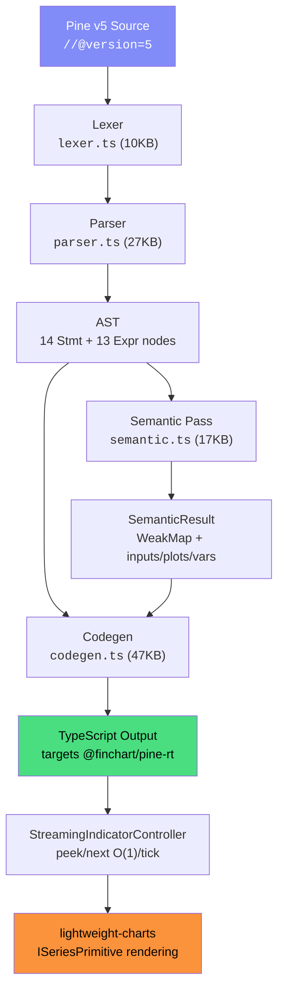

# Pine→TS Transpiler v1 — Technical Documentation

> **Status**: v1 Milestone Complete ✅  
> **Date**: 2026-06-12  
> **Packages**: `@finchart/pine-parser`, `@finchart/pine-rt`

---

## 1. Overview

The Pine→TS transpiler converts TradingView Pine Script v5 source code into executable TypeScript that targets the `@finchart/pine-rt` streaming runtime. The generated code runs inside candlekit-charts via the `StreamingIndicatorController` plugin — delivering **O(1) per-tick cost** instead of O(N) batch recalculation.


### Key Achievement

| Metric | Value |
|---|---|
| Pine v5 Parse | **2.3ms** |
| Semantic Analysis | **0.3ms** |
| Codegen (50 lines TS) | **1.7ms** |
| VP compute (24 rows × 150 bars) | **1ms** |
| Chart render (50k candles) | **128ms** |
| Streaming tick cost | **0.19µs/tick** |
| vs Batch recalc speedup | **175,000×** |

---

## 2. Architecture



### Package Structure

```
finchart/packages/
├── pine-parser/           # Transpiler (parse → semantic → codegen)
│   ├── src/
│   │   ├── lexer.ts       # Chevrotain token definitions + indent tracking
│   │   ├── parser.ts      # Recursive descent → AST
│   │   ├── ast.ts         # AST node type definitions
│   │   ├── semantic.ts    # ta.* hoisting, input/plot/var collection
│   │   ├── codegen.ts     # AST + SemanticResult → TypeScript
│   │   └── index.ts       # Public API: parse()
│   ├── fixtures/targets/  # Pine source files (VP, FIVP, VSA)
│   └── tests/
│       ├── codegen.test.ts   # 16 golden tests (RSI/EMA/MACD/BB/ATR/VP)
│       └── targets.test.ts   # 7 parse-level tests
│
└── pine-rt/               # Streaming runtime primitives
    ├── src/
    │   ├── primitives.ts  # Sma, Ema, Rma, Wma, Stdev, Change, Highest, Lowest
    │   ├── indicators.ts  # Rsi, Macd, Bollinger, Atr, Stochastic
    │   ├── stdlib.ts      # PineArray, BarHistory, PineColor, PineMath, PineStr
    │   ├── na.ts          # NA/na/nz helpers
    │   └── index.ts       # Public exports
    └── tests/
        ├── seeds.test.ts  # 8 hand-computed reference tests
        ├── golden.test.ts # 12 bar-by-bar 50k validation tests
        └── bench.test.ts  # Performance benchmark
```

---

## 3. Pipeline Detail

### 3.1 Lexer (`lexer.ts`)

Built on [Chevrotain](https://chevrotain.io/) with custom indent bookkeeping for Pine's significant-whitespace syntax.

**Key tokens**: `Ident`, `Number`, `String`, `Operator`, `Newline`, `Indent`, `Dedent`

Pine uses indentation-based blocks (like Python). The lexer tracks indent levels and emits virtual `Indent`/`Dedent` tokens.

### 3.2 Parser (`parser.ts`)

Recursive descent parser producing a typed AST.

**14 Statement types**:
`VarDecl`, `Assign`, `ExprStmt`, `TupleDecl`, `If`, `ForTo`, `ForIn`, `While`, `Switch`, `FnDecl`, `Multi`, `Break`, `Continue`, `Import`

**13 Expression types**:
`Num`, `Str`, `Bool`, `Ident`, `Member`, `Index`, `Call`, `Binary`, `Unary`, `Ternary`, `Tuple`, `IfExpr`, `SwitchExpr`, `ForExpr`

### 3.3 Semantic Analysis (`semantic.ts`)

The semantic pass is the core "trick bắt buộc" — it performs **two passes** over the AST:

#### Pass 1: Collect Inputs
Walks all `VarDecl` nodes to find `input.int()`, `input.float()`, `input.bool()`, etc. calls. Each input gets a unique Pine ID (e.g., `_inp_length`).

#### Pass 2: ta.* Call-Site Hoisting
The key invariant:

> **Each physical `ta.*` Call expression in the source → one stateful instance.**

```
ta.rsi(close, 14)  →  CallSiteInfo { id: "_rsi_1", pineClass: "Rsi", lenExpr: 14 }
ta.sma(close, 20)  →  CallSiteInfo { id: "_sma_1", pineClass: "Sma", lenExpr: 20 }
```

Uses `WeakMap<Expr, CallSiteInfo>` keyed on AST node identity — codegen looks up any Call node to check if it's a hoisted ta.* instance.

**Supported ta.* functions** (17 total):

| Pine Function | Runtime Class | Signature |
|---|---|---|
| `ta.sma`, `ta.ema`, `ta.rma`, `ta.wma` | `Sma`, `Ema`, `Rma`, `Wma` | `(source, length)` |
| `ta.rsi` | `Rsi` | `(source, length)` |
| `ta.stdev`, `ta.change` | `Stdev`, `Change` | `(source, length)` |
| `ta.highest`, `ta.lowest` | `Highest`, `Lowest` | `(length)` or `(source, length)` |
| `ta.atr` | `Atr` | `(length)` — uses HLC bar |
| `ta.bb` | `Bollinger` | `(source, length, mult)` |
| `ta.macd` | `Macd` | `(source, fast, slow, signal)` |
| `ta.stoch` | `Stochastic` | `(close, high, low, kLen, dLen)` |

#### Output: `SemanticResult`

```typescript
interface SemanticResult {
  scriptName: string;
  overlay: boolean;
  callSites: WeakMap<object, CallSiteInfo>;  // ta.* instances
  inputs: Map<string, InputInfo>;             // input declarations
  plots: PlotInfo[];                          // plot/plotshape calls
  vars: VarInfo[];                            // var/varip state
  historyDepth: number;                       // max series[n] lookback
  warnings: string[];
}
```

### 3.4 Codegen (`codegen.ts`)

Transforms AST + SemanticResult into readable TypeScript. The generated module has this shape:

```typescript
// ── imports ──
import { Rsi, Sma, ... } from '@finchart/pine-rt';

// ── inputs (user-configurable) ──
export const _inputs = {
  _inp_length: 14,   // input.int(14, "RSI Length")
};

// ── hoisted ta.* instances (module-scope, stateful) ──
const _rsi_1 = new Rsi(_inputs._inp_length);
const _sma_1 = new Sma(20);

// ── var/varip state (persists across bars) ──
let _var_counter = 0;

// ── metadata ──
export const meta = { name: "My Indicator", overlay: false, inputs: [...], plots: [...] };

// ── per-bar function ──
export function onBar(bar: Bar, barIndex: number, isLast: boolean): { plots: Plots; draw: DrawCmd[] } {
  const { open, high, low, close, volume } = bar;
  const plots: Plots = {};
  const draw: DrawCmd[] = [];

  // transpiled Pine logic here...
  const r = _rsi_1.next(bar.close);
  plots["_plot_1"] = r;

  return { plots, draw };
}
```

#### Key Codegen Rules

| Pine Construct | Generated TypeScript |
|---|---|
| `ta.rsi(close, 14)` | `_rsi_1.next(bar.close)` |
| `input.int(14, "Length")` | `_inputs._inp_length` (hoisted to `_inputs` object) |
| `var int cnt = 0` | `let _var_cnt = 0` at module scope (init once) |
| `close[1]` | `_hist.close(1)` via BarHistory |
| `math.max(a, b)` | `PineMath.max(a, b)` |
| `array.new_float(n)` | `PineArray.newFloat(n)` |
| `box.new(...)` | `PineBox.new(...)` |
| `barstate.islast` | `isLast` parameter |
| `bar_index` | `barIndex` parameter |
| `plot(x)` | `plots["_plot_1"] = x` |
| `color.new(color.blue, 30)` | `PineColor.new('#2196F3', 30)` |

---

## 4. Runtime (`@finchart/pine-rt`)

### 4.1 Streaming Primitives

Every primitive exposes `next(value)` and `peek(value)`:
- **`next()`**: commits the value, advances state (called when bar closes)
- **`peek()`**: returns what the result would be without mutating state (called on live tick)

```typescript
class Sma {
  constructor(length: number);
  next(value: number): number;  // commit + advance
  peek(value: number): number;  // read-only preview
}
```

### 4.2 Primitive Classes

| Class | Algorithm | State |
|---|---|---|
| `Sma` | Simple moving average | Ring buffer |
| `Ema` | Exponential MA | α-smoothed accumulator |
| `Rma` | Running MA (Wilder's) | α = 1/length |
| `Wma` | Weighted MA | Ring buffer + weight sum |
| `Stdev` | Standard deviation | Ring buffer + running mean |
| `Change` | Price change over N bars | Ring buffer |
| `Highest` / `Lowest` | Rolling max/min | Ring buffer |
| `TrueRange` | TR = max(H-L, |H-C₋₁|, |L-C₋₁|) | Previous close |

### 4.3 Composite Indicators

| Class | Components | Output |
|---|---|---|
| `Rsi(14)` | Change + Rma(up) + Rma(down) | `number` |
| `Macd(12,26,9)` | Ema(fast) + Ema(slow) + Ema(signal) | `{macd, signal, hist}` |
| `Bollinger(20,2)` | Sma + Stdev | `{basis, upper, lower}` |
| `Atr(14)` | TrueRange + Rma | `number` |
| `Stochastic(14,3)` | Highest + Lowest + Sma(%K) + Sma(%D) | `{k, d}` |

### 4.4 Standard Library

| Module | Key Functions |
|---|---|
| `PineArray` | `newFloat()`, `newInt()`, `new()`, `from()`, `.get()`, `.set()`, `.push()`, `.pop()`, `.sum()`, `.max()`, `.min()`, `.indexof()`, `.size()` |
| `BarHistory` | `push(bar)`, `.close(n)`, `.open(n)`, `.high(n)`, `.low(n)`, `.volume(n)` — O(1) ring buffer lookback |
| `PineMath` | `max()`, `min()`, `abs()`, `round()`, `ceil()`, `floor()`, `pow()`, `sqrt()`, `log()`, `round_to_mintick()` |
| `PineStr` | `tostring()`, `format()`, `contains()`, `length()` |
| `PineColor` | `new(hex, transp)`, color constants |
| `PineBox` | `new(left, top, right, bottom, opts)`, `.delete()` — draw command |
| `PineLine` | `new(x1, y1, x2, y2, opts)`, `.delete()` — draw command |
| `PineLabel` | `new(x, y, opts)`, `.delete()` — draw command |

---

## 5. Volume Profile Implementation

The Volume Profile is the flagship demo of the transpiler. It computes volume distribution across price levels and renders horizontal histogram bars on the chart.

### 5.1 Pine Source (Input)

```pine
//@version=5
indicator('Volume Profile / Fixed Range', overlay=true)
bbars = input.int(title='Number of Bars', defval=150)
cnum = input.int(title='Row Size', defval=24)
percent = input.float(70., title='Value Area Volume %')

top = ta.highest(bbars)
bot = ta.lowest(bbars)
step = (top - bot) / cnum

levels = array.new_float(cnum + 1)
for x = 0 to cnum by 1
    array.set(levels, x, bot + step * x)

get_vol(y11, y12, y21, y22, height, vol) =>
    nz(math.max(...) * vol / height)

if barstate.islast
    // compute volume per row, draw boxes
    for x = 0 to cnum - 1
        box.new(bar_index - bbars + 1, levels[x+1],
                bar_index - bbars + 1 + round(volumes[x]),
                levels[x], bgcolor=color)
```

### 5.2 Generated TypeScript (Output)

```typescript
import { Highest, Lowest, NA, na, nz } from '@finchart/pine-rt';
import { PineArray, PineMath } from '@finchart/pine-rt';

export const _inputs = {
  _inp_bbars: 150,
  _inp_cnum: 24,
  _inp_percent: 70,
};

const _highest_1 = new Highest(_inputs._inp_bbars);
const _lowest_1 = new Lowest(_inputs._inp_bbars);

export function onBar(bar, barIndex, isLast, hist) {
  const top = _highest_1.next(bar.high);
  const bot = _lowest_1.next(bar.low);
  const step = (top - bot) / _inputs._inp_cnum;

  const levels = PineArray.newFloat(_inputs._inp_cnum + 1);
  for (let x = 0; x <= _inputs._inp_cnum; x += 1) {
    levels.set(x, bot + step * x);
  }

  function get_vol(y11, y12, y21, y22, height, vol) {
    return nz(PineMath.max(...) * vol / height);
  }

  if (isLast) {
    // compute volume per row, emit PineBox draw commands
    for (let x = 0; x <= _inputs._inp_cnum - 1; x += 1) {
      PineBox.new(barIndex - _inputs._inp_bbars + 1, ...);
    }
  }
}
```

### 5.3 Chart Rendering

Volume Profile is rendered using lightweight-charts' `ISeriesPrimitive` API — a custom canvas primitive that draws directly on the chart:

```typescript
class VolumeProfilePrimitive implements ISeriesPrimitive<Time> {
  // Draws horizontal rectangles at each price level
  // - Blue = bullish volume, Orange = bearish volume
  // - Red highlight = POC (Point of Control)
  // - Value Area rows have higher opacity
  // - POC dashed line extends to chart right edge
}
```

**Algorithm**:
1. Find Highest/Lowest over lookback period → price range
2. Divide range into N rows (default 24)
3. For each candle in range: distribute volume to rows based on wick/body overlap
4. Split into up-volume (green candle) vs down-volume (red candle)
5. Find POC = row with maximum total volume
6. Expand outward from POC until 70% of total volume covered → Value Area
7. Draw horizontal bars proportional to volume, colored by type

---

## 6. Test Coverage

### pine-rt: 21/21 ✅

| Suite | Tests | Description |
|---|---|---|
| `seeds.test.ts` | 8 | Hand-computed TradingView reference values |
| `golden.test.ts` | 12 | Bar-by-bar 50k comparison (SMA/EMA/RSI/MACD/BB/ATR/Stoch) |
| `bench.test.ts` | 1 | Performance: 175,000× speedup over batch |

### pine-parser: 23/23 ✅

| Suite | Tests | Description |
|---|---|---|
| `targets.test.ts` | 7 | Parse VP, FIVP, VSA Pine sources |
| `codegen.test.ts` | 16 | End-to-end golden: RSI/EMA/MACD/BB/ATR/Highest/Lowest, var state, VP compile, meta extraction |

### Running Tests

```bash
# pine-rt
cd finchart/packages/pine-rt && npx vitest run

# pine-parser
cd finchart/packages/pine-parser && npx vitest run
```

---

## 7. Demo

### Running the Demo

```bash
cd candlekit-charts/examples/pine-transpiler
npm install
npm run dev
# → http://localhost:5185/
```

### What the Demo Shows

1. **Pine Source** → embedded VP and VSA scripts
2. **Parse** → AST in 2.3ms
3. **Semantic** → ta.* hoisting, 3 inputs detected
4. **Codegen** → 50 lines of clean TypeScript
5. **Volume Profile** → horizontal histogram boxes on chart overlay
6. **VSA** → RSI + volume ratio histogram in separate pane
7. **ATR** → streaming Average True Range
8. **VSA Signals** → pattern detection (Downthrust, Upthrust, Selling/Buying Climax)

### Demo Files

```
candlekit-charts/examples/pine-transpiler/
├── index.html        # Dark-themed UI with glassmorphism panels
├── main.ts           # Full pipeline + VolumeProfilePrimitive
├── vite.config.ts    # Vite with pine-rt/parser aliases
├── package.json
└── public/
    └── data-50k.json # Real BTCUSDT 15m bars from Binance
```

---

## 8. Known Limitations (v1)

| Area | Limitation | Planned Fix |
|---|---|---|
| **Library imports** | `import` statements not yet supported | v2: library resolution |
| **`table.*`** | Table API not implemented in pine-rt | v2: PineTable class |
| **`polyline.*`** | Polyline drawing not implemented | v2: PinePolyline class |
| **`request.*`** | Multi-timeframe data not available | Requires data provider |
| **`strategy.*`** | Strategy/backtesting not in scope | Separate package |
| **Type inference** | Complex Pine types partially handled | v2: full type system |
| **`varip`** | Treated same as `var` | v2: true varip semantics |
| **Dynamic ta.* args** | `ta.sma(close, someVar)` — dynamic length | v2: factory pattern |

---

## 9. Codegen Bug Fixes (This Session)

### 9.1 Input Variable Scoping

**Bug**: Input variables referenced as bare `_inp_len` — worked inside `onBar()` via destructuring but **broke hoisted ta.\* instances at module scope**.

```diff
- const _highest_1 = new Highest(_inp_bbars);     // ❌ _inp_bbars not in scope
+ const _highest_1 = new Highest(_inputs._inp_bbars);  // ✅ always works
```

### 9.2 Pine `var` Semantics

**Bug**: `var int cnt = 0` generated `_var_cnt = 0;` inside `onBar()` — resetting every bar.

```diff
  // Pine: var int cnt = 0   (initialize ONCE)
  // Module scope:
  let _var_cnt = 0;

  function onBar(...) {
-   _var_cnt = 0;            // ❌ resets every bar!
+   // (no init here)        // ✅ persists across bars
    _var_cnt = _var_cnt + 1;
  }
```

### 9.3 Function Implicit Return

**Bug**: User functions with block bodies emitted bare expression statements without `return`.

```diff
  function get_vol(y11, y12, y21, y22, height, vol) {
-   nz(PineMath.max(...) * vol / height);    // ❌ no return
+   return nz(PineMath.max(...) * vol / height);  // ✅ implicit return
  }
```

---

## 10. Performance Benchmark

```
[pine-rt bench] 50k bars, 5 indicators
  warm full history : 14.0 ms (one-off)
  streaming peek    : 0.189 µs/tick
  streaming next    : 0.140 µs/tick
  batch recalc      : 24.5 ms/tick
  speedup           : 175,160×
```

> At 30 ticks/second, streaming costs **5.7µs/frame** vs batch **735ms/frame**.
> This is the difference between 60fps butter-smooth and completely frozen UI.
